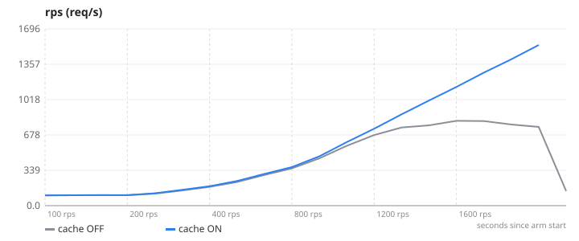
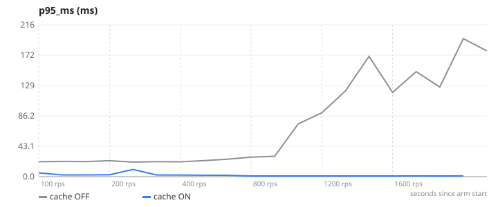
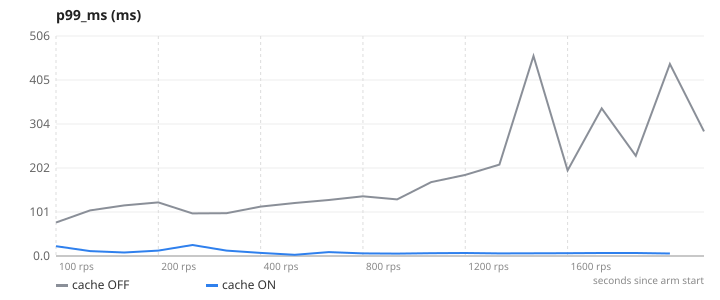
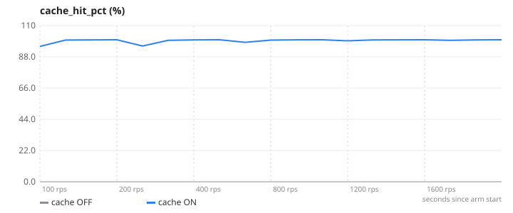
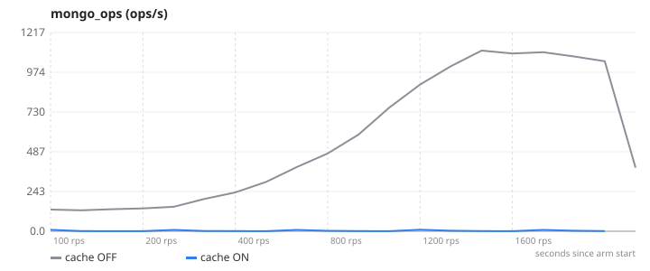
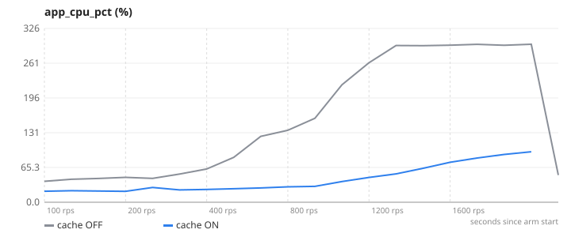

# 01-caching — Caching with Redis (cache-aside)

**Question.** How much latency and throughput does cache-aside buy on the catalogue read path?

**Concept.** Read-heavy endpoints hit MongoDB on every request. A cache-aside layer answers repeated reads from Redis and only falls through to Mongo on a miss; writes bump a namespace version so stale entries are never served.

**What changes between arms.** CACHE_ENABLED=false → true (lib/cache.js wraps the read routes; controllers untouched)

## Result

| metric | cache OFF | cache ON | change |
|---|---:|---:|---:|
| max RPS with p95 < 300 ms | 814 | 1542 | +89 % |
| p95 at 400 req/s | 25.1 | 1.7 | -93 % |
| Mongo ops/s at 400 req/s | 390.5 | 4 | -99 % |
| cache hit rate (avg) | – | 99.3 |  |

- **cache OFF**: 3 replica(s), `CACHE_ENABLED=false`, 1 run(s) (median shown)
- **cache ON**: 3 replica(s), `CACHE_ENABLED=true`, 1 run(s) (median shown)
- Load: `browse.js`, ramp 100 → 200 → 400 → 800 → 1200 → 1600 req/s, 45 s per stage, open model (arrival rate), through nginx to the replicas.
- SLA used for "max RPS": p95 < 300 ms and errors < 1 %. Generated 2026-11-10 18:17 UTC.

## Charts

### rps


### p95_ms


### p99_ms


### cache_hit_pct


### mongo_ops


### app_cpu_pct


## k6 view (client side)

| arm | requests | failed | p95 | p99 |
|---|---:|---:|---:|---:|
| cache OFF | 124411 | 0.2 % | 3775.2 ms | 5657.8 ms |
| cache ON | 159731 | 0 % | 2.5 ms | 7.1 ms |

## What this does NOT prove

- One laptop runs the load generator, nginx, three 1-CPU replicas, Mongo and Redis; absolute numbers are machine-specific, the delta is the result.
- The browse mix is 35 % photo requests (~54 KB bodies), which is where cache-aside pays most.

## Reproduce

```
make lab
make experiment E=01-caching            # add ARGS="--repeats 3" for medians of 3, ARGS="--quick" for a 1-minute demo
```
