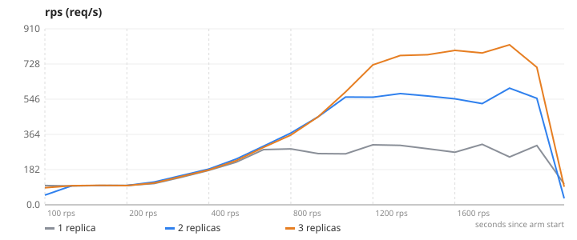
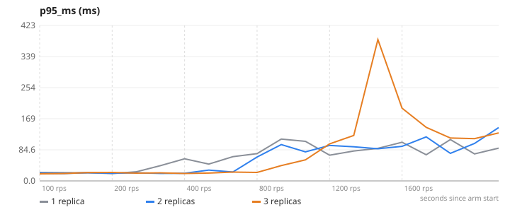
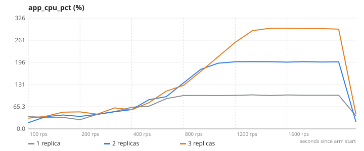
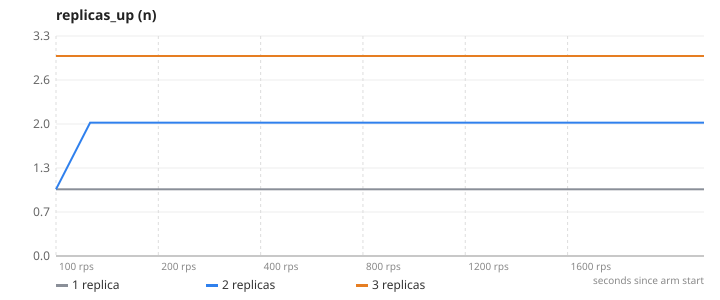

# 02-scale-out — Horizontal scaling behind a load balancer

**Question.** How does maximum sustainable throughput change with 1, 2 and 3 app replicas?

**Concept.** Instead of a bigger machine, run more copies of the stateless app and spread requests across them. nginx discovers the replicas through DNS and round-robins; each replica is capped at 1 CPU so the count is what changes, not the size.

**What changes between arms.** docker compose --scale app=1 → 2 → 3 (nothing in the code)

## Result

| metric | 1 replica | 2 replicas | 3 replicas | change |
|---|---:|---:|---:|---:|
| max RPS with p95 < 300 ms | 313 | 603 | 827 | +164 % |
| p95 at 400 req/s | 62 | 39.6 | 22.9 | -63 % |
| p95 at 800 req/s | 97.2 | 91.5 | 66.6 | -31 % |
| peak app CPU (sum of replicas) | 100.1 | 198.2 | 296.8 | +197 % |

- **1 replica**: 1 replica(s), `CACHE_ENABLED=false`, 1 run(s) (median shown)
- **2 replicas**: 2 replica(s), `CACHE_ENABLED=false`, 1 run(s) (median shown)
- **3 replicas**: 3 replica(s), `CACHE_ENABLED=false`, 1 run(s) (median shown)
- Load: `browse.js`, ramp 100 → 200 → 400 → 800 → 1200 → 1600 req/s, 45 s per stage, open model (arrival rate), through nginx to the replicas.
- SLA used for "max RPS": p95 < 300 ms and errors < 1 %. Generated 2026-11-10 18:33 UTC.

## Charts

### rps


### p95_ms


### app_cpu_pct


### replicas_up


## k6 view (client side)

| arm | requests | failed | p95 | p99 |
|---|---:|---:|---:|---:|
| 1 replica | 122494 | 48.6 % | 2947.5 ms | 14467.8 ms |
| 2 replicas | 110297 | 9.5 % | 4274.8 ms | 5821.0 ms |
| 3 replicas | 123352 | 0.3 % | 3855.0 ms | 5844.2 ms |

## What this does NOT prove

- All replicas, nginx, k6, Mongo and Redis share one laptop's cores; scaling stops paying off once the host is saturated. The AWS run (3 real instances) is the honest version.
- Cache is OFF so every request reaches Mongo; the shared database becomes the ceiling before the replicas do.

## Reproduce

```
make lab
make experiment E=02-scale-out            # add ARGS="--repeats 3" for medians of 3, ARGS="--quick" for a 1-minute demo
```
