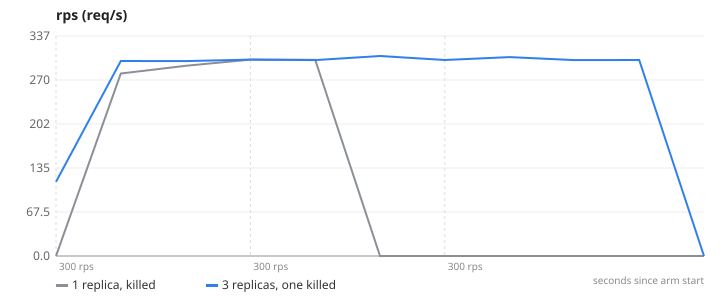
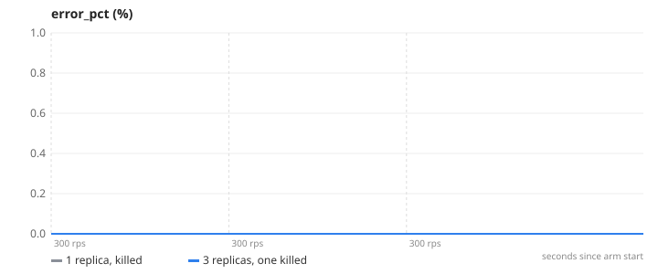
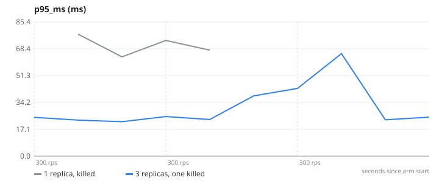
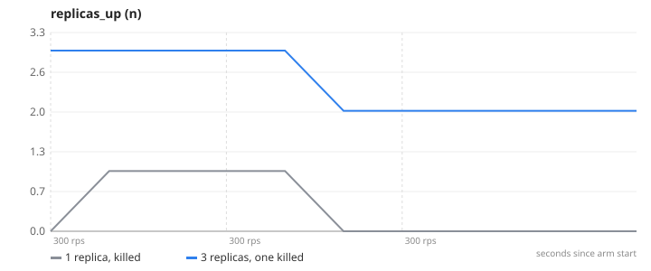

# 03-fault-tolerance — Fault tolerance — a replica dies under load

**Question.** What do users see when one app instance is killed mid-traffic, with 1 replica vs 3?

**Concept.** Redundancy means one instance can fail without the service failing. The load balancer stops routing to the dead replica (DNS entry disappears, nginx re-resolves within 5 s and retries failed connections on another replica) and the survivors absorb its share.

**What changes between arms.** docker stop one app container 60 s into a steady 300 req/s load (stop, not kill — see caveats)

## Result

| metric | 1 replica, killed | 3 replicas, one killed | change |
|---|---:|---:|---:|
| requests failed | 56.2 | 0 | -100 % |
| average throughput over the run (req/s) | 106.6 | 256.9 | +141 % |

- **1 replica, killed**: 1 replica(s), `CACHE_ENABLED=false`, 1 run(s) (median shown)
- **3 replicas, one killed**: 3 replica(s), `CACHE_ENABLED=false`, 1 run(s) (median shown)
- Load: `browse.js`, ramp 300 → 300 → 300 req/s, 45 s per stage, open model (arrival rate), through nginx to the replicas.
- SLA used for "max RPS": p95 < 300 ms and errors < 1 %. Generated 2026-11-10 18:56 UTC.

## Charts

### rps


### error_pct


### p95_ms


### replicas_up


## k6 view (client side)

| arm | requests | failed | p95 | p99 |
|---|---:|---:|---:|---:|
| 1 replica, killed | 40279 | 56.2 % | 588.2 ms | 2000.0 ms |
| 3 replicas, one killed | 40480 | 0 % | 112.9 ms | 218.1 ms |

## What this does NOT prove

- [object Object]
- Server-side metrics only see requests that reached an app; connection refusals show up in k6's failed % (k6 view in the report), which is the user's view.
- Failover time here is nginx's DNS re-resolve interval (5 s); an AWS ALB uses health-check thresholds instead (Phase 3 measures that).

## Reproduce

```
make lab
make experiment E=03-fault-tolerance            # add ARGS="--repeats 3" for medians of 3, ARGS="--quick" for a 1-minute demo
```
