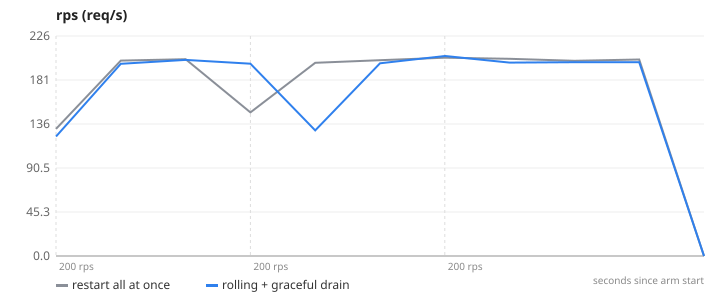
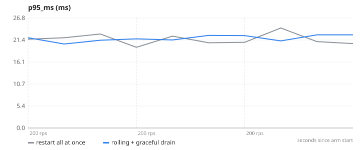
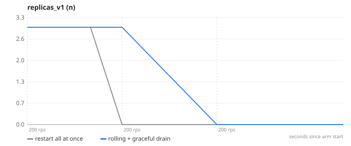
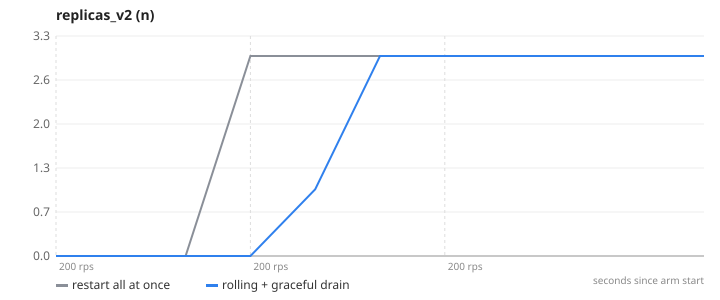

# 04-rolling-deploy — Rolling deploy with graceful shutdown vs restart-everything

**Question.** How many user requests fail during a v1 → v2 deploy, naive vs rolling, under steady 200 req/s?

**Concept.** Deploying by restarting every instance at once means a window where nothing answers. A rolling deploy starts a new-version instance, waits until it is healthy and reachable through the load balancer, then drains one old instance (SIGTERM → stop accepting, finish in-flight requests, exit) and repeats. The service never has fewer healthy instances than before.

**What changes between arms.** lab/hooks/deploy.sh naive → rolling (+ the SIGTERM drain handler in server.js)

## Result

| metric | restart all at once | rolling + graceful drain | change |
|---|---:|---:|---:|
| requests failed during the run | 0.3 | 0 | -100 % |
| replicas on v2 at the end | 3 | 3 | +0 % |

- **restart all at once**: 3 replica(s), `CACHE_ENABLED=false GRACEFUL_SHUTDOWN=false APP_VERSION=v1`, 1 run(s) (median shown)
- **rolling + graceful drain**: 3 replica(s), `CACHE_ENABLED=false GRACEFUL_SHUTDOWN=true APP_VERSION=v1`, 1 run(s) (median shown)
- Load: `browse.js`, ramp 200 → 200 → 200 req/s, 45 s per stage, open model (arrival rate), through nginx to the replicas.
- SLA used for "max RPS": p95 < 300 ms and errors < 1 %. Generated 2026-11-11 04:14 UTC.

## Charts

### rps


### p95_ms


### replicas_v1


### replicas_v2


## k6 view (client side)

| arm | requests | failed | p95 | p99 |
|---|---:|---:|---:|---:|
| restart all at once | 27008 | 0.3 % | 64.5 ms | 127.1 ms |
| rolling + graceful drain | 26983 | 0 % | 76.3 ms | 2001.1 ms |

## What this does NOT prove

- v2 is the same image with a different APP_VERSION; a real deploy also pulls a new image, which only lengthens the naive outage.
- nginx discovers replicas by DNS every 5 s, so the rolling script waits 6 s after each add/remove; an ALB does this with health checks and deregistration delay (Phase 3 measures that path).
- Rolling takes ~3× longer than naive by design; the trade is deploy time for zero user-visible errors.

## Reproduce

```
make lab
make experiment E=04-rolling-deploy            # add ARGS="--repeats 3" for medians of 3, ARGS="--quick" for a 1-minute demo
```
