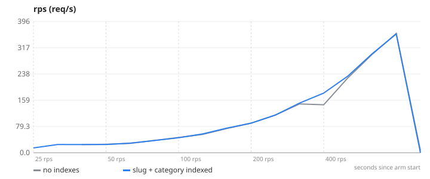
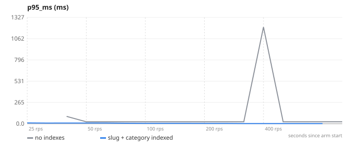
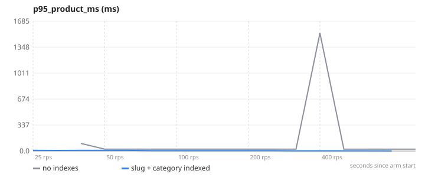
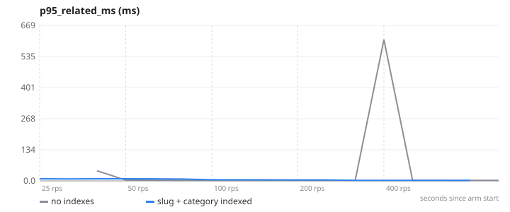
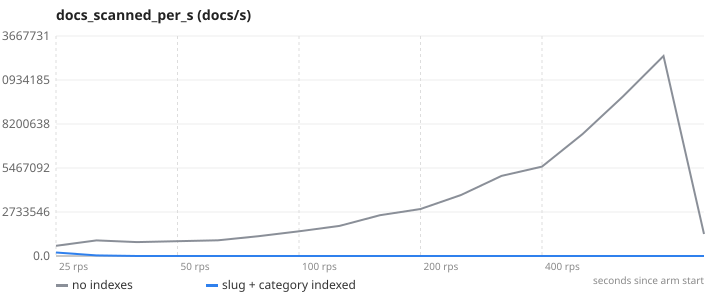
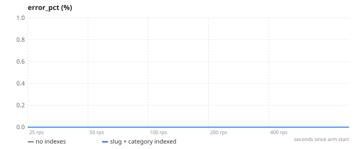

# 05-db-index — Database indexing — collection scans vs B-tree lookups

**Question.** What do indexes on slug and category do to lookup latency and Mongo work at 50k products?

**Concept.** Without an index, findOne({slug}) and find({category}) read every document in the collection (a collection scan, O(n)); with an index Mongo walks a B-tree and touches only matching documents (O(log n)). The effect is invisible at 5,000 products and brutal at 50,000, so this experiment seeds 50,000 and watches "documents scanned per second".

**What changes between arms.** db.products.createIndex({slug:1}) and createIndex({category:1}) — no code change

## Result

| metric | no indexes | slug + category indexed | change |
|---|---:|---:|---:|
| max RPS with p95 < 300 ms | 360 | 358 | -1 % |
| product-by-slug p95 at 100 req/s (ms) | 24.3 | 4.5 | -81 % |
| Mongo documents scanned per second at 100 req/s | 2441220.8 | 190.1 | -100 % |

- **no indexes**: 3 replica(s), `CACHE_ENABLED=false SEED_PRODUCTS=50000 SEED_PHOTO_PX=64`, 1 run(s) (median shown)
- **slug + category indexed**: 3 replica(s), `CACHE_ENABLED=false SEED_PRODUCTS=50000 SEED_PHOTO_PX=64`, 1 run(s) (median shown)
- Load: `catalog.js`, ramp 25 → 50 → 100 → 200 → 400 req/s, 45 s per stage, open model (arrival rate), through nginx to the replicas.
- SLA used for "max RPS": p95 < 300 ms and errors < 1 %. Generated 2026-11-11 04:06 UTC.

## Charts

### rps


### p95_ms


### p95_product_ms


### p95_related_ms


### docs_scanned_per_s


### error_pct


## k6 view (client side)

| arm | requests | failed | p95 | p99 |
|---|---:|---:|---:|---:|
| no indexes | 26103 | 0 % | 18.3 ms | 127.8 ms |
| slug + category indexed | 26478 | 0 % | 5.2 ms | 15.7 ms |

## What this does NOT prove

- 50,000 products with 64 px photos (so the dataset fits); the other experiments use 5,000 with 256 px photos.
- Search (`/search/:keyword`) is a case-insensitive regex and cannot use these indexes; that needs a text index or a search engine (see the experiments backlog).
- [object Object]

## Reproduce

```
make lab
make experiment E=05-db-index            # add ARGS="--repeats 3" for medians of 3, ARGS="--quick" for a 1-minute demo
```
