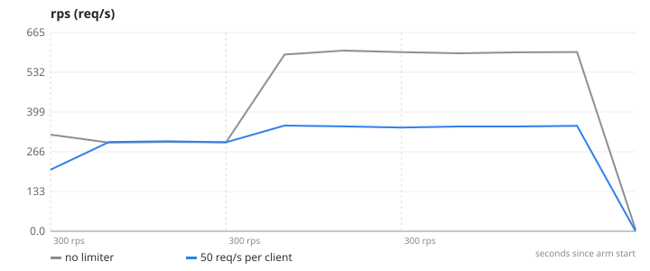
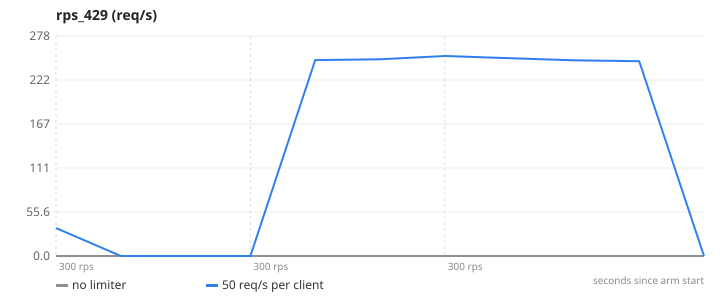
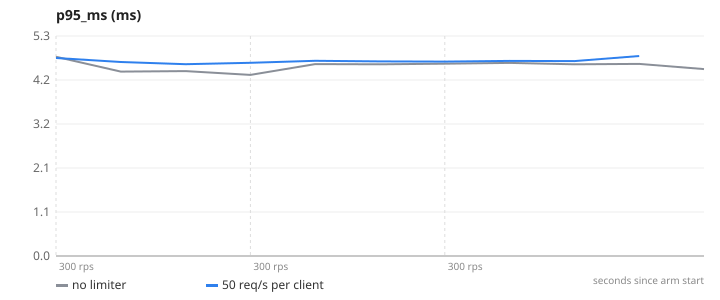
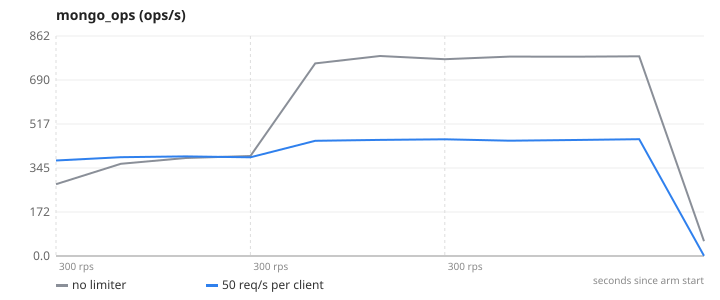
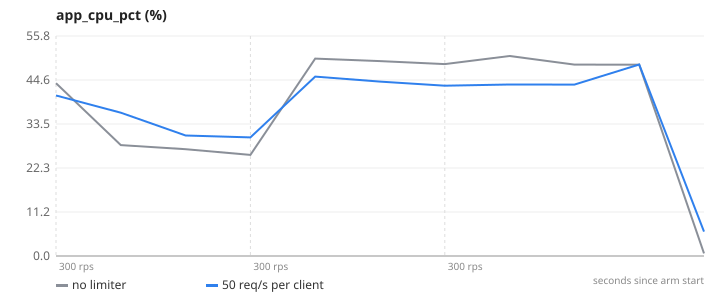

# 06-rate-limit — Rate limiting — one abusive client vs everyone else

**Question.** When one client sends 300 req/s, what happens to normal users with and without a limiter?

**Concept.** A shared Redis counter per client and per second rejects requests above a quota with HTTP 429 before they reach the database. Because the counter lives in Redis, the quota holds across all replicas. The goal is not to slow the abuser down for its own sake but to keep the other users' latency flat while it hammers.

**What changes between arms.** RATE_LIMIT_ENABLED=false → true, RATE_LIMIT_RPS=50 per client (lib/ratelimit.js)

## Result

| metric | no limiter | 50 req/s per client | change |
|---|---:|---:|---:|
| normal users' p95 (ms) | 3.5 | 3.8 | +9 % |
| normal users' requests rejected (fraction) | 0 | 0 |  |
| abuser's requests rejected (fraction) | 0 | 0.8 |  |
| peak Mongo ops/s | 784.1 | 458 | -42 % |

- **no limiter**: 3 replica(s), `CACHE_ENABLED=false RATE_LIMIT_ENABLED=false`, 1 run(s) (median shown)
- **50 req/s per client**: 3 replica(s), `CACHE_ENABLED=false RATE_LIMIT_ENABLED=true RATE_LIMIT_RPS=50`, 1 run(s) (median shown)
- Load: `abuse.js`, ramp 300 → 300 → 300 req/s, 45 s per stage, open model (arrival rate), through nginx to the replicas.
- SLA used for "max RPS": p95 < 300 ms and errors < 1 %. Generated 2026-11-11 04:06 UTC.

## Charts

### rps


### rps_429


### p95_ms


### mongo_ops


### app_cpu_pct


## k6 view (client side)

| arm | requests | failed | p95 | p99 |
|---|---:|---:|---:|---:|
| no limiter | 67511 | 0 % | 3.5 ms | 4.0 ms |
| 50 req/s per client | 67510 | 33.3 % | 3.7 ms | 4.9 ms |

## What this does NOT prove

- k6 is one IP, so clients are identified by an X-Client-Id header; production keys on the authenticated user or the real client IP from the load balancer.
- Fixed 1-second windows allow up to 2× the quota across a window boundary; a token bucket or sliding log is stricter at the cost of more Redis work.
- The abuser here is polite HTTP; a network-level flood needs the limit at the edge (ALB/WAF/CDN), not in the app.

## Reproduce

```
make lab
make experiment E=06-rate-limit            # add ARGS="--repeats 3" for medians of 3, ARGS="--quick" for a 1-minute demo
```
