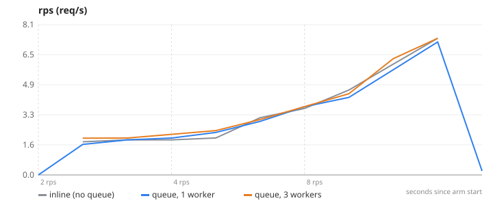
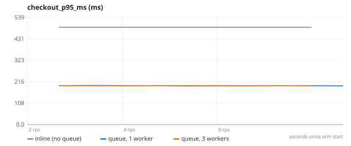
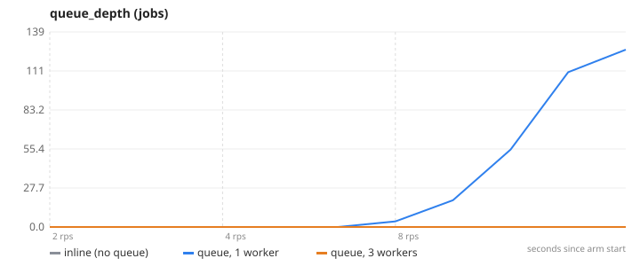
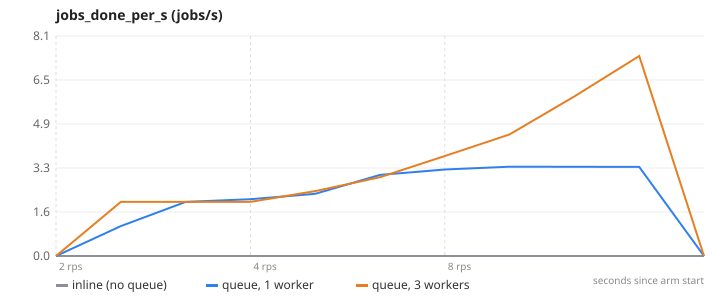
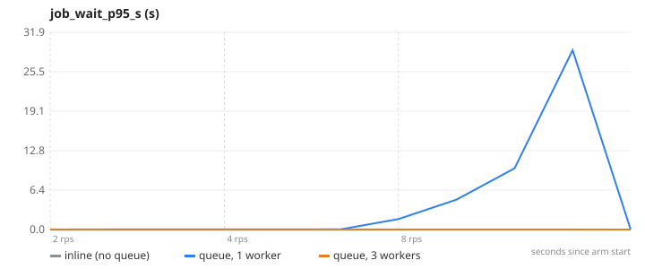

# 07-async-queue — Async processing — move slow post-checkout work to a queue

**Question.** What happens to checkout latency when the 300 ms post-order work moves to a queue, and how does worker count affect queue depth?

**Concept.** After a payment the shop sends a confirmation email and builds an invoice. Done inline, the user waits for the email provider on every checkout. Done asynchronously, the request only enqueues a job in Redis (BullMQ) and returns; separate worker processes drain the queue, and you scale the workers to match the inflow. The user-facing latency decouples from the provider's latency.

**What changes between arms.** QUEUE_ENABLED=false → true; workers 1 → 3 (lib/postorder.js, worker.js)

## Result

| metric | inline (no queue) | queue, 1 worker | queue, 3 workers | change |
|---|---:|---:|---:|---:|
| checkout p95 as the user sees it (ms) | 488.4 | 183.0 | 184.1 | -62 % |
| peak queue depth (jobs) | 0 | 126 | 0 |  |
| worst p95 time a job waited (s) | 0 | 29 | 0 |  |

- **inline (no queue)**: 3 replica(s), `CACHE_ENABLED=false PAYMENT_MOCK=true QUEUE_ENABLED=false POST_ORDER_WORK_MS=300`, 1 run(s) (median shown)
- **queue, 1 worker**: 3 replica(s), `CACHE_ENABLED=false PAYMENT_MOCK=true QUEUE_ENABLED=true POST_ORDER_WORK_MS=300`, 1 run(s) (median shown)
- **queue, 3 workers**: 3 replica(s), `CACHE_ENABLED=false PAYMENT_MOCK=true QUEUE_ENABLED=true POST_ORDER_WORK_MS=300`, 1 run(s) (median shown)
- Load: `checkout.js`, ramp 2 → 4 → 8 req/s, 45 s per stage, open model (arrival rate), through nginx to the replicas.
- SLA used for "max RPS": p95 < 1000 ms and errors < 1 %. Generated 2026-11-11 04:22 UTC.

## Charts

### rps


### checkout_p95_ms


### queue_depth


### jobs_done_per_s


### job_wait_p95_s


## k6 view (client side)

| arm | requests | failed | p95 | p99 |
|---|---:|---:|---:|---:|
| inline (no queue) | 496 | 0 % | 488.4 ms | 493.0 ms |
| queue, 1 worker | 496 | 0 % | 182.9 ms | 188.9 ms |
| queue, 3 workers | 497 | 0 % | 184.1 ms | 187.9 ms |

## What this does NOT prove

- The "email provider" is a 300 ms sleep plus a Mongo insert; a real provider is slower and flakier, which only strengthens the case.
- The payment gateway is the local mock (PAYMENT_MOCK=true, ~120–180 ms) so the sandbox is not hammered; the delta between arms is unaffected.
- [object Object]

## Reproduce

```
make lab
make experiment E=07-async-queue            # add ARGS="--repeats 3" for medians of 3, ARGS="--quick" for a 1-minute demo
```
