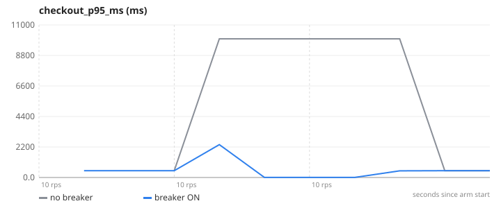
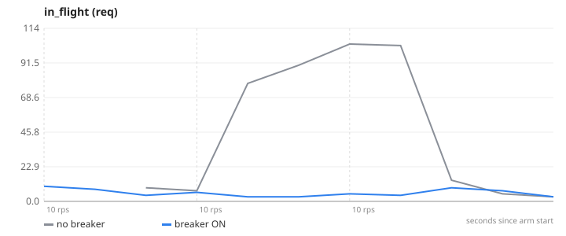
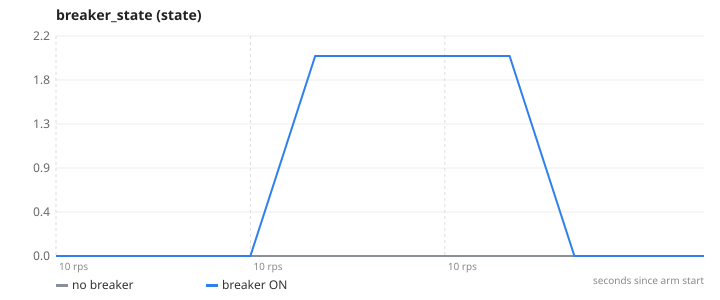
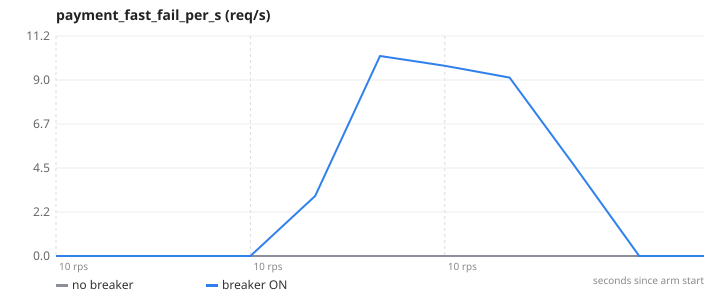
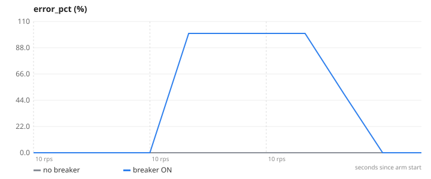

# 08-circuit-breaker — Circuit breaker — when the payment provider hangs

**Question.** With the payment provider hanging mid-run, what do checkout latency and the catalogue's latency look like with and without a breaker?

**Concept.** A dependency that hangs is worse than one that errors: every request holds a connection and a worker slot until it times out, and the pile-up spreads to unrelated endpoints. A circuit breaker tracks failures; after a threshold it "opens" and fails calls immediately for a cooling period, then lets a trial request through (half-open) to detect recovery. Users get a fast, honest error instead of a 10 s wait, and the rest of the site stays healthy.

**What changes between arms.** BREAKER_ENABLED=false → true (lib/payments.js, opossum; 2 s timeout, opens at 50 % failures, 10 s reset)

## Result

| metric | no breaker | breaker ON | change |
|---|---:|---:|---:|
| checkout p95 over the whole run (ms) | 10312.5 | 2003.9 | -81 % |
| slowest checkout (ms) | 10321.5 | 2009.4 | -81 % |
| peak requests stuck in flight | 104 | 10 | -90 % |
| worst 15 s checkout error rate (%) | 0 | 100 |  |

- **no breaker**: 3 replica(s), `CACHE_ENABLED=false PAYMENT_MOCK=true BREAKER_ENABLED=false`, 1 run(s) (median shown)
- **breaker ON**: 3 replica(s), `CACHE_ENABLED=false PAYMENT_MOCK=true BREAKER_ENABLED=true`, 1 run(s) (median shown)
- Load: `checkout.js`, ramp 10 → 10 → 10 req/s, 45 s per stage, open model (arrival rate), through nginx to the replicas.
- SLA used for "max RPS": p95 < 1000 ms and errors < 1 %. Generated 2026-11-11 04:27 UTC.

## Charts

### checkout_p95_ms


### in_flight


### breaker_state


### payment_fast_fail_per_s


### error_pct


## k6 view (client side)

| arm | requests | failed | p95 | p99 |
|---|---:|---:|---:|---:|
| no breaker | 1299 | 0 % | 10312.5 ms | 10315.3 ms |
| breaker ON | 1351 | 49.2 % | 2003.9 ms | 2007.1 ms |

## What this does NOT prove

- Both arms fail checkouts while the provider is down — the breaker does not make payments succeed, it makes failure fast (ms instead of 10 s) and stops the pile-up.
- The hang is simulated in the payment mock (PAYMENT_MOCK_HANG via a Redis flag read per call); a real outage also degrades slowly first, which is where error-rate thresholds matter.
- The circuit is per replica (opossum is in-process); each of the 3 replicas opens on its own evidence.

## Reproduce

```
make lab
make experiment E=08-circuit-breaker            # add ARGS="--repeats 3" for medians of 3, ARGS="--quick" for a 1-minute demo
```
