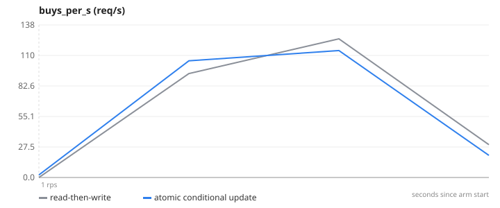
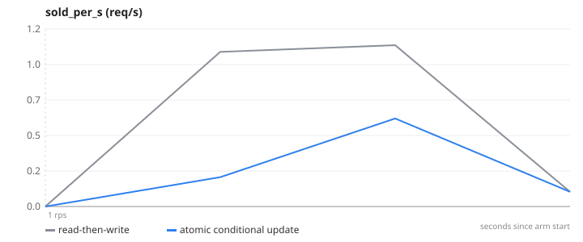

# 09-oversell — Concurrency control — 200 buyers, 1 unit in stock

**Question.** With one unit in stock and 200 simultaneous buyers, how many units get sold with read-then-write vs an atomic conditional update?

**Concept.** "Read the stock, check it, then write stock−1" is two operations; between them another request can do the same, and both sell the last unit. Across 3 replicas there is no process-level lock that helps. The fix is to make the check and the write one atomic operation at the database — findOneAndUpdate with the condition quantity > 0 and $inc — so exactly one buyer wins.

**What changes between arms.** OVERSELL_MODE=naive → atomic (routes/labRoutes.js)

## Result

| metric | read-then-write | atomic conditional update | change |
|---|---:|---:|---:|
| rounds (1 unit in stock each) | 20 | 20 | +0 % |
| units actually sold | 44 | 20 | -55 % |
| buyers told "sold out" | 3956 | 3980 | +1 % |

- **read-then-write**: 3 replica(s), `CACHE_ENABLED=false OVERSELL_MODE=naive`, 1 run(s) (median shown)
- **atomic conditional update**: 3 replica(s), `CACHE_ENABLED=false OVERSELL_MODE=atomic`, 1 run(s) (median shown)
- Load: `oversell.js`, ramp 1 req/s, 1 s per stage, open model (arrival rate), through nginx to the replicas.
- SLA used for "max RPS": p95 < 1000 ms and errors < 100 %. Generated 2026-11-11 04:09 UTC.

## Charts

### buys_per_s


### sold_per_s


## k6 view (client side)

| arm | requests | failed | p95 | p99 |
|---|---:|---:|---:|---:|
| read-then-write | 4021 | 98.4 % | 1386.8 ms | – |
| atomic conditional update | 4021 | 99.0 % | 1450.5 ms | – |

## What this does NOT prove

- 200 virtual users fire within a few ms of each other; a real flash sale has thousands over seconds, which makes the naive race more likely, not less.
- The atomic update is per document; a cart with several products needs a multi-document transaction or per-item reservation — the next concept up.
- [object Object]

## Reproduce

```
make lab
make experiment E=09-oversell            # add ARGS="--repeats 3" for medians of 3, ARGS="--quick" for a 1-minute demo
```
