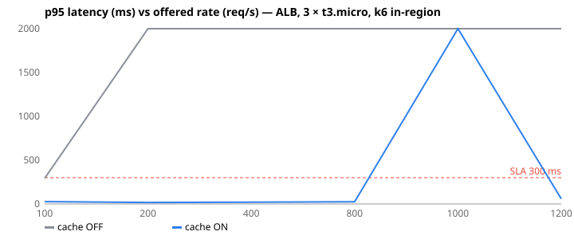

# 10-aws — Deployed on AWS — 3 × t3.micro behind an Application Load Balancer

**Question.** What throughput and latency does the deployed app sustain, with and without the Redis cache?

**Concept.** The local lab shares one laptop between everything. This run uses the production shape: three separate EC2 instances in three availability zones behind an ALB that health-checks /healthz, a separate data instance for Mongo and Redis, and a load generator in the same region so the numbers are the servers' numbers, not the internet's. Built and torn down with OpenTofu (infra/).

**What changes between arms.** SSM parameter /shopease/CACHE_ENABLED false → true + redeploy (lib/cache.js)

## Result

| metric | cache OFF | cache ON | change |
|---|---:|---:|---:|
| max sustained req/s with p95 < 300 ms | 100 | 800 | +700 % |
| p95 at 400 req/s (ms) | 21060.1 | 20.3 | -100 % |
| p95 at 800 req/s (ms) | 28492.2 | 24.8 | -100 % |
| achieved req/s when offered 1,200 | 121.5 | 955.0 | +686 % |
| failures when offered 1,200 req/s (%) | 0 | 0 |  |



### cache OFF

| offered req/s | achieved req/s | failed | p50 | p95 | p99 | photo p95 | search p95 |
|---:|---:|---:|---:|---:|---:|---:|---:|
| 100 | 98.6 | 0 % | 20.2 ms | 292.2 ms | 704.7 ms | 187.9 ms | 489.2 ms |
| 200 | 134.0 | 0.0 % | 3476.3 ms | 9864.9 ms | 12306.2 ms | 6139.9 ms | 19224.2 ms |
| 400 | 124.8 | 0 % | 10054.8 ms | 21060.1 ms | 25755.4 ms | 12194.2 ms | 42928.2 ms |
| 800 | 121.4 | 0 % | 11572.5 ms | 28492.2 ms | 35431.4 ms | 18390.1 ms | 36001.2 ms |
| 1000 | 120.2 | 0.0 % | 10296.5 ms | 32441.5 ms | 37036.0 ms | 21506.5 ms | 41762.1 ms |
| 1200 | 121.5 | 0 % | 10616.2 ms | 25244.7 ms | 31703.3 ms | 16083.3 ms | 35835.4 ms |

### cache ON

| offered req/s | achieved req/s | failed | p50 | p95 | p99 | photo p95 | search p95 |
|---:|---:|---:|---:|---:|---:|---:|---:|
| 100 | 94.9 | 0 % | 4.7 ms | 26.4 ms | 208.7 ms | 10.5 ms | 43.8 ms |
| 200 | 199.9 | 0 % | 4.2 ms | 16.9 ms | 218.7 ms | 8.2 ms | 35.5 ms |
| 400 | 399.6 | 0 % | 4.1 ms | 20.3 ms | 111.3 ms | 13.7 ms | 34.5 ms |
| 800 | 794.7 | 0 % | 4.2 ms | 24.8 ms | 78.5 ms | 21.4 ms | 35.9 ms |
| 1000 | 327.2 | 0.9 % | 4.9 ms | 36852.4 ms | 59744.6 ms | 21.6 ms | 54801.5 ms |
| 1200 | 955.0 | 0 % | 4.8 ms | 58.4 ms | 159.1 ms | 56.3 ms | 69.4 ms |

- Load generator: k6 0.55 on a t3.small in the same region, one constant-rate run of 40 s per rate, browse mix (list 30 %, product 20 %, photo 35 %, search 10 %, categories 5 %).
- "Max sustainable" = highest offered rate whose run achieved ≥ 90 % of it with p95 < 300 ms and failures < 1 %.
- Generated 2026-11-11 12:13 UTC.

## What this does NOT prove

- t3.micro instances are burstable; the first attempt ran out of CPU credits at 1,200 req/s (P-30). Instances now run with unlimited credits; each rate ran 40 s.
- Mongo and Redis share one t3.small (2 GB) with a 0.5 GB WiredTiger cache for a 310 MB dataset; with the cache off that single box is the ceiling (it was OOM-killed until the app's connection pool was cut from 100 to 20 per instance, P-31). A managed replica set (Atlas) or a bigger data instance is the next lever.
- List/product cache entries expire after 60 s, so at ~1,000 req/s the expiry moment sends a burst of misses to Mongo (the cache-stampede experiment in the backlog); it shows as the p99 spikes in the cached arm.
- Single region, HTTP only, no autoscaling, no CDN yet (Phase 4); the ALB alone adds ~1 ms.

## Reproduce

```
make infra-apply                      # 3 × t3.micro + ALB + data + loadgen (ap-southeast-2)
make aws-bench ARM=uncached           # toggles CACHE_ENABLED in SSM, redeploys, sweeps rates from the loadgen
make aws-bench ARM=cached
make aws-report
make infra-destroy
```
