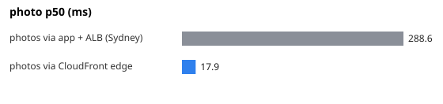

# 11-cdn — CDN — product photos from CloudFront edges vs from the app in Sydney

**Question.** What does a user far from the region see for photo latency, app-served vs CDN-served?

**Concept.** Static files do not need to come from the application server. Uploading photos to S3 and serving them through CloudFront puts copies at edge locations close to the user, takes the bytes off the app instances and the database, and lets browsers cache them for a year (immutable URLs). The measurement is taken from the author's laptop in India against a stack in Sydney — distance is the point.

**What changes between arms.** PHOTO_STORAGE=mongo (bytes from Mongo through the ALB) → s3 (302 to CloudFront; the k6 "cdn" mode hits the CDN URL directly)

## Result

| metric | photos via app + ALB (Sydney) | photos via CloudFront edge | change |
|---|---:|---:|---:|
| photo p50 (ms) | 288.6 | 17.9 | -94 % |
| photo p95 (ms) | 555.9 | 46.8 | -92 % |
| time to first byte p50 (ms) | 285.0 | 15.6 | -95 % |
| failed (%) | 0 | 0 |  |

- Generated 2026-11-11 13:23 UTC from `experiments/11-cdn/results/<arm>.k6.json`.

## What this does NOT prove

- Measured from one laptop on one ISP (India → Sydney ≈ 150–900 ms RTT depending on the path); numbers vary by location, the ratio is the message.
- [object Object]
- The first request for each photo at an edge is a miss (fetched from S3 in Sydney); with 60 photos and hundreds of requests the hit rate is high, as it would be for popular products.
