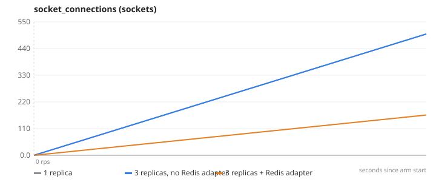
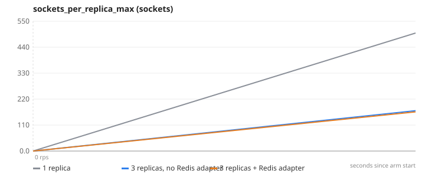
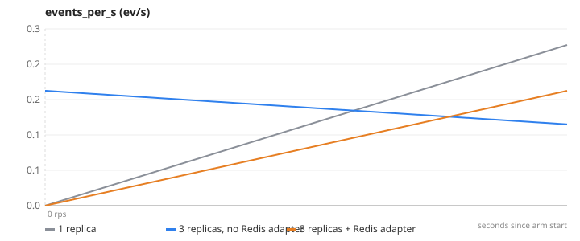

# 12-realtime — Real-time push — one update, hundreds of sockets, several replicas

**Question.** With 1 replica vs 3, how many sockets receive the update and how fast?

**Concept.** A WebSocket is a long-lived connection to ONE replica. When the admin updates an order on replica A, the buyer's browser may be connected to replica B. socket.io's Redis adapter relays every emit through Redis pub/sub so each replica delivers to its own sockets. The experiment opens hundreds of sockets (spread by the load balancer), flips an order's status through the API, and measures delivery.

**What changes between arms.** replicas 1 → 3 behind nginx, then the Redis adapter off → on (REALTIME_ADAPTER)

## Result

| metric | 1 replica | 3 replicas, no Redis adapter | 3 replicas + Redis adapter | change |
|---|---:|---:|---:|---:|
| sockets connected | 500 | 500 | 500 | +0 % |
| replicas the sockets landed on | 1 | 3 | 3 | +200 % |
| updates delivered (5 rounds) | 2500 | 829 | 2500 | +0 % |
| updates lost | 0 | 1671 | 0 |  |
| delivery p95 (ms, API call → socket) | 32 | 22 | 43 | +34 % |

- **1 replica**: 1 replica(s), `CACHE_ENABLED=false PAYMENT_MOCK=true`, 1 run(s) (median shown)
- **3 replicas, no Redis adapter**: 3 replica(s), `CACHE_ENABLED=false PAYMENT_MOCK=true REALTIME_ADAPTER=false`, 1 run(s) (median shown)
- **3 replicas + Redis adapter**: 3 replica(s), `CACHE_ENABLED=false PAYMENT_MOCK=true REALTIME_ADAPTER=true`, 1 run(s) (median shown)
- Load: `lab/realtime/fanout.js`, ramp 0 req/s, 1 s per stage, open model (arrival rate), through nginx to the replicas.
- SLA used for "max RPS": p95 < 1000 ms and errors < 1 %. Generated 2026-11-11 12:37 UTC.

## Charts

### socket_connections


### sockets_per_replica_max


### events_per_s


## k6 view (client side)

| arm | requests | failed | p95 | p99 |
|---|---:|---:|---:|---:|
| 1 replica | 5 | 0 % | 0 ms | 0 ms |
| 3 replicas, no Redis adapter | 5 | 0 % | 0 ms | 0 ms |
| 3 replicas + Redis adapter | 5 | 0 % | 0 ms | 0 ms |

## What this does NOT prove

- Delivery time includes the admin's HTTP request to the API (through nginx) plus the Redis relay plus the WebSocket hop; on one laptop all of that is sub-millisecond network, so the number is mostly scheduling.
- 500 sockets is the laptop's comfortable range; the AWS run uses the same script from the loadgen instance against the ALB.
- The test client uses WebSocket transport only; browsers that fall back to long-polling would need load-balancer stickiness.

## Reproduce

```
make lab
make experiment E=12-realtime            # add ARGS="--repeats 3" for medians of 3, ARGS="--quick" for a 1-minute demo
```
